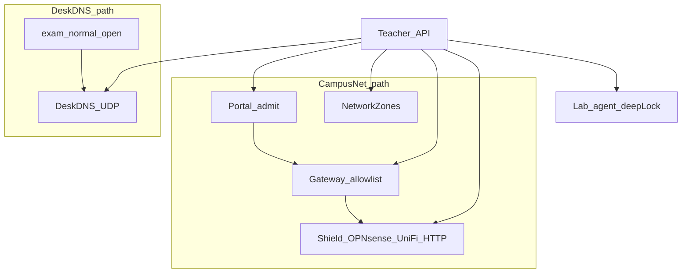

# 等保 / 密评材料级控制矩阵（网络与防火墙）

> **范围：** 校园网包（Shield + 门户 + Zones + 放行表）与单网校包（DeskDNS）**双线并行**。  
> **定位：** 在「校安运维级」（失败闭合、无假成功、可审计）之上，补控制矩阵、日志留存、账号分权与证据包，供学校信息中心 / 密评材料引用。  
> **非承诺：** 本文不替代正式等保测评报告；不宣称产品已通过某级等保认证。材料由学校 IT 结合本校拓扑填证。  
> **S 档声明：** `security_tier_s=1`（默认）是学校硬化档（审计链、OR 双线门闩、禁未映射软放行）。  
> **最高保密档：** `max_secrecy_mode=1`（默认）是**产品内最严机制**：双线 **AND**；HMAC 审计 + 密封镜像；敏感配置 **AES-GCM 落盘**；深锁再认证；**放行/下课/关保密档双人规则**；考试态心跳失败 **加深锁+踢班**；员工 JWT **15 分钟 + IP 绑定**；空域（禁 mDNS/beacon/GitHub 轮询/联邦 Hub）；生产 **HTTPS 登录**；禁公开深锁态 / 一键连班。**不是**国家秘密 / 绝密信息系统。单网校仅 DeskDNS 时须关闭最高保密档、保留 S 档。

相关：[`SECURITY.md`](./SECURITY.md) · [`PERMISSIONS.md`](./PERMISSIONS.md) · [`NETWORK.md`](./NETWORK.md) · [`PILOT_SKU.md`](./PILOT_SKU.md) · [`CLASSROOM_JOIN_SECURITY.md`](./CLASSROOM_JOIN_SECURITY.md)

## 1. 双线架构（执行面）



| 线 | 断网机制 | 学校前置 | Pilot 旗标 |
|---|---|---|---|
| **校园网包** | 网关 alias / 防火墙按客户端授权 | OPNsense 或 UniFi API 凭据 + Captive→门户 | `netPortal` + `networkZones` + `gatewayAllowlist` + Shield≠off |
| **单网校包** | 教师机 DNS 污染/拦截（DeskDNS） | DHCP DNS→教师机；可选 :53 | `netDns` / 运行时 `netDnsRunning` |

两条可同时启用；深锁 UI 必须诚实显示「网关未断」当 Shield=`off`。

## 2. 控制矩阵（密评常用类）

| 控制类 | 要求摘要 | 产品实现 | 证据 |
|---|---|---|---|
| **身份鉴别** | 教师/助教/学生分角色；敏感操作需鉴权 | JWT + `requireRoles`；深锁/Zones/DeskDNS 写 = teacher/admin | [`PERMISSIONS.md`](./PERMISSIONS.md)；`e2e/assistant-rbac` |
| **访问控制** | 默认拒绝未映射网；教工网可强制门户 | Zones + `unmapped_zone` block；`private_device_portal_only`；SSID 签名可选强制 | 门户拦截大字条；`portalAuth` 单测 |
| **安全审计** | 操作可追溯；留存可配置 | `teacher_audit_log`；网络动作前缀 `deep_lock.*` / `shield.*` / `deskdns.*` / `portal.*` | 审计导出；`audit_retention_days`（默认 **180**） |
| **通信完整/保密** | 生产宜 TLS | 教室默认可 HTTP；生产见 TLS 反代文档 | [`TLS_REVERSE_PROXY.md`](./TLS_REVERSE_PROXY.md) |
| **入侵防范 / 边界** | 考试网默认拒绝；失败不装成功 | Shield `off`→`ok:false`；authorize 失败记 `shield_*_fail` + 顶栏错误 | `shieldOffDefault` / `shieldReleaseFail`；对账 API |
| **恶意代码防范** | 不做隐蔽间谍功能 | 禁止键鼠/剪贴板暗采；锁可见 | [`SECURITY.md`](./SECURITY.md) 否决项 |
| **资源控制** | 课节结束收回放行 | 下课收工 / `deep_lock.end`：epoch 作废 + 放行表清 + Shield release | 下课确认抽屉；审计 `deep_lock.end` |
| **剩余信息保护** | 导出脱敏 | live-shield / compliance 证据包脚本去凭据 | `check:live-evidence`；`export:compliance-evidence` |

## 3. 账号分权（网络面）

| 能力 | admin | teacher | assistant |
|---|:---:|:---:|:---:|
| 查看 Shield / 放行表 / DeskDNS 状态 | ✓ | ✓ | ✓ |
| 深锁 freeze / exam_net / kick / end | ✓ | ✓ | — |
| 改 Network Zones / 门户强制签名 | ✓ | ✓ | — |
| 改 DeskDNS profile（exam/normal/open） | ✓ | ✓ | — |
| Shield 向导 ping / 写适配器 | ✓ | ✓ | — |
| 导出审计 / 合规证据包 | ✓ | ✓ | 审计只读导出 ✓；合规包 teacher/admin |
| 批准陌生设备连班 | ✓ | ✓ | —（UI 只读提示） |

助教：**只读**网络态势与审计，**不可**改断网面。与 [`PERMISSIONS.md`](./PERMISSIONS.md) 同步。

## 4. 日志留存与防篡改（最高保密档）

| 项 | 默认 | 说明 |
|---|---|---|
| `audit_retention_days` | **180** | 教师审计表按日滚动删除（调度器）；可 30–730；**改留存 / 清理 = admin + 再认证** |
| 哈希链 | `prev_hash` / `row_hash` | **HMAC-SHA256**（`hmac1:` + `AUDIT_HMAC_KEY`/`JWT_SECRET`）；兼容旧纯 SHA-256；`GET /api/v1/compliance/audit-chain` |
| 密封镜像 | `data/audit-seal/audit.jsonl` | 只追加；**SQLite purge 不删** |
| 合规证据包 | JSON + `.sha256` + `.hmac` | `contentSha256` + `packHmac`；`X-Pack-HMAC` |
| live 归档 | admin | 无学校 LIVE 仍写 SKIPPED；**不升 GA** |

**不可篡改声明：** HMAC 链 + 密封镜像可检出应用层改写；**不**防物理磁盘级攻击或密钥失窃。密评应另做 NAS 只读快照 / WORM / SIEM，并保管 `AUDIT_HMAC_KEY`。

## 5. 失败闭合（双线 · 最高保密档加严）

| 场景 | 期望行为 |
|---|---|
| 最高保密档：Shield 或 DeskDNS 缺一 | **拒绝** freeze/exam_net/kick（`max_secrecy_dual_path`） |
| 深锁收紧无 `confirmPassword` | **403** `reauth_required` |
| `allow_net` / 下课 / 关最高保密档 | **双人**：`confirmPassword` + `secondPassword`（教师↔管理员） |
| 考试态心跳失败 | 加深冻结 + **踢全班** + 禁 `allow_net`；审计 `maxsec.heartbeat_fail_lockdown` |
| 员工会话 | JWT ≤15min + `bindIp`；错 IP → `ip_bind_mismatch` |
| 空域 | 停 mDNS / UDP beacon / GitHub 轮询 / 联邦 Hub |
| 敏感配置 | `shield_http_token` 等 `enc1:` AES-GCM（`AUDIT_HMAC_KEY`） |
| 公开深锁态 | `GET /deep-lock/public` **403** |
| 生产登录 | 非回环须 HTTPS（`tls_required`） |

## 6. 证据包清单

```bash
# 脱敏合规包（本地/试点）
npm run export:compliance-evidence
# 或教师设置 → 校园网包 →「一键导出合规包」

# 网关 alias 对账（读 OPNsense allow/block alias vs 本地放行表）
curl -sS -H "Authorization: Bearer $TOKEN" \
  http://127.0.0.1:8787/api/v1/compliance/alias-reconcile | jq .

# 网关 lab 三图（不可顶替学校真机）
npm run archive:opennds-lab
npm run archive:live-shield   # 无 LIVE 凭据 → SKIPPED；仍写 net-reconcile + GA_HARD_GATE.md
npm run check:live-evidence

# 对账（需教师 token）
curl -sS -H "Authorization: Bearer $TOKEN" \
  http://127.0.0.1:8787/api/v1/compliance/net-reconcile | jq .
```

### GA 硬门槛（不变）

| 可做 | 不可宣称 GA |
|---|---|
| lab `archive:opennds-lab` / `lab:opnsense` alias 对账 | 仅有 SKIPPED manifest |
| 教师端导出合规包 + 审计留存 | 无学校 `OPNSENSE_LIVE=1` / `UNIFI_LIVE=1` 真机通过 |
| DeskDNS follow 深锁 | 把 lab 证据写成「验收通过」 |

学校真机截图与凭据归档见 [`OPNSENSE_ACCEPTANCE.md`](./OPNSENSE_ACCEPTANCE.md) / [`UNIFI_ACCEPTANCE.md`](./UNIFI_ACCEPTANCE.md)。**无学校 live 证据不得宣称 GA**（[`PILOT_SKU.md`](./PILOT_SKU.md)）。

## 6b. DeskDNS ↔ 深锁联动

默认 `deskdns_follow_deeplock=1`：`freeze` / `exam_net` / `kick_class` → DeskDNS `exam`（DNS NXDOMAIN，门户域除外）；`end` / `allow_net` → 恢复 stash。可在设置页关闭。

## 7. 密评材料引用建议（学校填写）

1. 拓扑图：教室 VLAN、门户跳转、Shield 网关、DeskDNS DHCP 指向。  
2. 附本页控制矩阵 + 角色表截图。  
3. 附连续 ≥30 天审计导出（或按本校策略）。  
4. 附一次深锁 freeze + 下课收工全链路审计。  
5. 双线各一份：Shield health 通过记录 **或** DeskDNS `:53` 检测通过记录。
