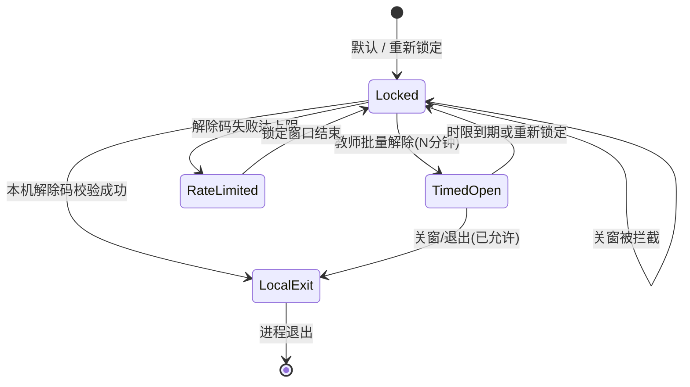

# 学生端退出锁定 · 应用层与 MDM/Kiosk

Classroom Desk 学生端默认**禁止关闭**（关窗、`Cmd/Ctrl+Q`、菜单退出）。允许退出的唯一正规途径：

1. 教师后台「批量允许关闭学生端」（限时；WebSocket/SSE 即时推送）
2. 本机「设置」输入解除码（或管理密码）后退出

## 锁定状态机



| 状态 | 学生标题栏 | 能否退出 |
|---|---|---|
| Locked | 已锁定 | 否 |
| TimedOpen | 可退出 m:ss | 是 |
| LocalExit | （正在退出） | 是 |
| RateLimited | 已锁定 | 否（需等 Retry-After） |

## 应用层已覆盖

| 路径 | 行为 |
|---|---|
| 无框窗口关闭 | 拦截，提示并跳转「设置」 |
| 应用菜单 / 快捷键退出 | 无菜单；`before-quit` 拦截 |
| `admin:quit` IPC | 未解锁拒绝 |
| 教师批量解除 | WebSocket `/api/v1/exit-lock/ws` + SSE `/api/v1/exit-lock/stream`；轮询兜底 |
| 解除码错误 | 可配置：次数 / 窗口分钟 / 锁定分钟 |
| 解除码轮换 | 教师可「系统生成并轮换」（最快 30s；明文仅本次响应）；超过 N 天（默认 90）设置页提醒 |

开发临时放开：`ALLOW_STUDENT_EXIT=1`。

自动化：

- `npm run verify:1plus1`（含 exit-lock 断言）
- `npm run verify:exit-lock-packaged`（打包产物静态校验；`dist:win` / CI windows-pack 会跑）

## 应用层挡不住的（需系统策略）

任务管理器「结束任务」、`taskkill /F`、`kill -9`、强制退出属于 **操作系统权限**。教室若要求系统级也关不掉，用学校 **MDM / 分配访问 / Kiosk**。

### Windows Assigned Access（单应用展台）

1. 建本地标准用户（如 `StudentKiosk`），不要给管理员权限。
2. 设置 → 帐户 → 家庭和其他用户 → **设置分配的访问权限**（Assigned Access）。
3. 选择该账户 → 选择应用 → **Classroom Desk**（若未列出：先用该账户登录一次安装的 app）。
4. 退出设置；用展台账户登录，应仅能进学生端。
5. 验证：`Ctrl+Alt+Del` / 任务管理器对展台账户不可用或无法结束被允许的应用（因 Windows 版本而异）。

### Intune / 组策略要点

- 配置文件限制：禁止任务管理器、限制「结束任务」。
- 可选：开机仅启动学生端（配合 `openAtLogin`）。
- 不要在教师机上开 Assigned Access。

#### Intune 自定义 OMA-URI 示例（参考）

将下列片段作为 **自定义配置文件** 的起点（按租户策略调整；先在试验机组验证）。完整样例文件：[`intune-student-kiosk.example.xml`](./intune-student-kiosk.example.xml)。

```xml
<!-- 概念示例：限制任务管理器 / 设置页 — 非生产即用，需学校 IT 审阅 -->
<Replace>
  <CmdID>1</CmdID>
  <Item>
    <Target>
      <LocURI>./Device/Vendor/MSFT/Policy/Config/Start/HideTaskManager</LocURI>
    </Target>
    <Meta><Format xmlns="syncml:metinf">int</Format></Meta>
    <Data>1</Data>
  </Item>
</Replace>
```

Assigned Access 多应用 / 桌面应用路径（electron-builder `productName: Classroom Desk`，NSIS 默认）：

| 场景 | 路径 |
|---|---|
| 默认 x64（「为所有用户安装」） | `C:\Program Files\Classroom Desk\Classroom Desk.exe` |
| ARM64（UTM / Snapdragon；`dist:win:arm64`） | 同路径；安装包名为 `ClassroomDesk-Setup-<ver>-arm64.exe` |
| 仅当前用户 / 自定义目录 | 开始菜单「Classroom Desk」→ 右键「打开文件位置」→ 复制实际 `.exe` |

JSON 片段（Intune「展台」或多应用 Assigned Access）：

```json
{
  "Account": "StudentKiosk",
  "Apps": [
    {
      "AppType": "DesktopApp",
      "DesktopAppPath": "C:\\Program Files\\Classroom Desk\\Classroom Desk.exe"
    }
  ]
}
```

**负向手测（任务管理器结束）**：展台账户登录 → `Ctrl+Alt+Del` 若仍能开任务管理器 → 对「Classroom Desk」点结束任务 → 期望失败或进程被策略立即拉起；普通管理员账户不在本测范围。

#### 试验机组部署 Intune XML

填写与回滚总表见 [`INTUNE_TRIAL_FILL.md`](./INTUNE_TRIAL_FILL.md)（22H2/24H2 必填；`verify:c2-evidence` 校验模板空白）。

1. Intune → 设备 → 配置 → 创建 → 「模板」/自定义 → 上传 [`intune-student-kiosk.example.xml`](./intune-student-kiosk.example.xml) 或按其中 OMA-URI 手工添加：
   - `HideTaskManager=1`
   - `Storage/RemovableDiskDenyWrite=1` + `RemovableDiskDenyExecute=1`（限制 USB 存储写/执行）
2. 分配到**试验组**（先 1～3 台样机），同步策略。
3. 样机：设置 → 系统 → 关于 → 确认 Windows 版本（记下 22H2/24H2 等）。
4. 验证：开始菜单无「任务管理器」或打开后策略阻止；插入 U 盘应无法写入；事件查看器 / `rsop` 可选。
5. 未生效：核对 CSP 在该版本是否支持，改用「开始」策略或 kiosk 配置，勿直接推全校。

#### 试验组回滚（必须可逆）

1. Intune → 取消试验组对该配置文件的分配 → 设备「同步」。
2. 或显式下发 [`intune-student-kiosk.rollback.xml`](./intune-student-kiosk.rollback.xml)（各 CSP `Data=0`）。
3. 样机验证：任务管理器可开、U 盘可写（若学校基线本就禁止 USB，以机房基线为准）。
4. 记录回滚时间与操作员到 `C2-intune-version.txt`。

#### 学生端崩溃看门狗（仅 MDM / 启动项 · 禁止隐蔽 Run）

- **允许**：Assigned Access 自动重启允许的应用；或学校 IT 用 **Startup 文件夹 / 已文档化的计划任务** 仅启动 `Classroom Desk.exe`（路径见上表）。
- **禁止**：向学生机写入隐蔽 `HKCU\\...\\Run`、静默持久化、对抗杀软的自恢复木马式逻辑。本仓库学生端**不**实现此类 Run 键。
- 教师「加固体检」页汇总 `/health` + presence `hardened`；可一键导出 Assigned Access 清单 JSON。

### 物理输入锁（教师可控 · 学生可见）

教师后台「学生端退出锁定 → 物理输入锁」可分别关闭学生端应用内的：

| 开关 | 学生端行为 |
|------|------------|
| 键盘 | 捕获阶段拦截 keydown/keyup（本窗口） |
| 鼠标/点击 | 拦截 pointer/click + 半透明遮罩；**白名单**保留「向教师举手」 |
| 语音 | 拒绝 `getUserMedia(audio)` / SpeechRecognition；停掉已有 tracks |
| 相机 | 拒绝 `getUserMedia(video)`；扫码失败文案引导粘贴 JSON |

**作用范围**：全校全局 / 当前班级 / 班级+机位（主键 `seat_map.id`；未排座机可选 presence `clientId`）。  
**考试模式**：一键键鼠语音相机全锁 + 退出重新锁定；可解除并恢复进考前快照。  
**投影大屏**：显示「全班输入锁」摘要 + 按班/机位明细（机位优先座位 label）。

操作路径（文字示意，勿提交海报 PDF）：

```text
备课 → 设置 → #input-lock-settings
  ├─ 作用范围：全局 | 当前班级 | 机位（seat_map.id）
  ├─ ☑ 禁止键盘 / 鼠标 / 语音 / 相机
  ├─ [全部锁定] [全部解除] [一键考试模式] [解除考试模式]
  └─ 审计「物理输入锁」含座位 label + id；可跳转 #input-lock-settings
```

- 输入锁实时通道：`GET /api/v1/input-lock/stream`（独立 SSE，避免 exit-lock 大包）；退出锁定仍走 `/exit-lock/ws` + SSE。  
- 审计 kind=`input_lock` / `exam_mode` / `exam_mode_end`；教师操作审计可一键跳转 `#input-lock-settings`。  
- **机位锁主键**：`seat_map.id`（`bySeat["${classId}:${seatId}"]`）。教师下拉优先座位图；`clientId` 仅用于未排座机位的机器锁。换人同座后旧生清掉 `cd_seat_id`，不会继续命中该座锁。  
- 学生端绑定当前 `seat_map.id` + label，并上报稳定 `presenceClientId`（localStorage）。座位变更走 `/api/v1/seat-bind/stream`，无需等 `/auth/me` 轮询。  
  - **全局/班级锁 + 未排座**：横幅 +「本机未排座，座锁未生效」。  
  - **仅机位锁 + 未排座**：无全局横幅，仅提示「座锁未命中」。  
- 「全部解除」（`clearAll`）清空全局/班级/机位，**并清除考试模式输入锁快照**（避免误恢复旧锁）。  
- USB：`CD_TOKEN` + `CD_CLASS_ID` 时 `prepare-usb-pack` 生成 `SEAT-MAP-ID-SHEET.html`（可扫码 seat_map.id 对照；页内「全部 / 仅空座 / 仅已排」筛选后打印；`--filter empty|seated` 设初始筛选）。
- 输入锁可按出勤课次 `end_at` 自动到期（设置页绑定 session；到期后 resolve 为空并写审计 `ttl_expire`）。
- 座位图：按行 / 列 / 全部一键锁空座（键鼠）。  
- 考试模式保存进考前快照，可一键「解除考试模式」恢复。  
- 断线对账 `POST /api/v1/auth/exit-lock-reconcile` 的 `clientId`：**机位/机器 id**（`cd_presence_client_id`），不是 classId、不是学号。  
- **不做** OS 级键鼠钩子、隐蔽监控或对抗杀软；系统热键/任务管理器依赖 Assigned Access + Intune（学校机房 **L3 必配**，见 [SECURITY.md](./SECURITY.md)）。  
- 「管住整台学生机」= **L3 MDM（IT）+ L2 本应用锁**；不是在学生端植入全盘控制木马或隐瞒采集。路线图见 [STUDENT_LOCK_HARDENING_PLAN.md](./STUDENT_LOCK_HARDENING_PLAN.md)。  
- e2e：`e2e/input-lock.spec.ts`（含 seat_map 机位锁 / seat-miss 互斥 / clearAll ConfirmModal）。手测多显示器 / 触控笔见 C2 打印表。

### 验证打包安装态退出锁定（C2 · 须在 Windows 真机）

本仓库 CI/代理机多为 macOS，**无法代替**教室 Windows 手测。打印下表到样机旁勾选；**证据**栏拍屏/录屏归档到教师机 `证据/C2-YYYYMMDD/`。

| # | 步骤 | 期望 | 证据 | □ |
|---|---|---|---|---|
| 1 | 安装 `ClassroomDesk-Setup-*.exe` | 安装成功 | 安装完成对话框 | |
| 2 | 写入 LAN `config.json`（禁止 127.0.0.1） | 能连 `/health` | 配置文件 + `/ready` | |
| 3 | 启动学生端；开「讲述人」 | 标题栏「已锁定」；读屏朗读锁定 | 标题栏截图 + 讲述人录音 10s | |
| 4 | 关窗 / Alt+F4 | 无法退出；toast「向教师申请解除」 | 录屏 | |
| 5 | 教师批量解除（确认框） | 学生秒级「可退出 m:ss」 | 师生同屏截图 | |
| 6 | 关窗 | 可退出 | 录屏 | |
| 7 | 教师重新锁定后再开学生端 | 再次无法关 | 截图 | |
| 8 | 解除码路径 | 可退；错码限流 | 截图 | |
| 9 | 教师审计 | 可筛选 kind（含 `code_rotated`）/ 导出 CSV | CSV 文件 | |
| 10 | Assigned Access + 上表路径 | 任务管理器无法结束 | 负向手测录屏 | |
| 11 | （可选）Intune HideTaskManager + USB 限制 | 试验组生效；U 盘不可写 | 策略同步截图 + USB 手测 | |
| 12 | **锁态 Alt+Tab / Win 键（真机）** | 展台账户下 Alt+Tab、Win 键无效或无法切到桌面/其它应用；仍困在 Classroom Desk | `C2-alttab-win.mp4` | |

静态检查：`npm run verify:exit-lock-packaged`（打包机 / CI `REQUIRE_WIN_EXE=1`；无 exe 硬失败）。Artifact：`classroom-desk-windows-setup`（保留 30 天）。总表见 [LOCAL_USB_CHECKLIST.md](./LOCAL_USB_CHECKLIST.md)「C2」。

### 学生端 WS → SSE 降级手测（DevTools）

1. 开发：学生端连上后，Chrome/Electron DevTools → Network → WS → 选中 `/exit-lock/ws` → 右键 **Close**（关掉该帧；勿长期 Offline，否则整页离线）。
2. 期望 toast：`实时通道已切到备用（WebSocket 关闭）`（或「断开」）；Network 出现 EventSource `/api/v1/exit-lock/stream`。
3. 教师批量解除 → 学生标题栏仍秒级变为「可退出」。
4. 自动化：
   - `npx playwright test e2e/exit-lock-ws.spec.ts`（WS/SSE 推送）
   - `STUDENT_WEB=http://127.0.0.1:5173 npx playwright test e2e/exit-lock-toast.spec.ts`（断言 toast 文案；需 `ELECTRON_OFF=1` 学生 Vite）

### C2 / Intune / Assigned Access 证据（样机操作员）

归档目录（教师机，勿提交 git）：`证据/C2-YYYYMMDD/`  

| 文件 | 内容 |
|---|---|
| `C2-narrator.mp4` | Win+Ctrl+Enter 讲述人 · 聚焦学生窗 · ≥10s · 须听清「已锁定」 |
| `C2-taskmgr-deny.mp4` | Assigned Access 展台账户 · 任务管理器结束失败/被拒 |
| `C2-titlebar.png` | 标题栏「已锁定」截图 |
| `C2-intune-version.txt` | 按 [`C2_intune-version.example.txt`](./C2_intune-version.example.txt) 填写 |
| `C2-intune-policy.png` | 试验组策略同步 / 开始菜单无任务管理器截图 |

- **Intune 试验组**：上传 [`intune-student-kiosk.example.xml`](./intune-student-kiosk.example.xml) → **仅**试验组 → 设备同步 → 填 `C2-intune-version.txt`。
- **Assigned Access 负向**：`C:\Program Files\Classroom Desk\Classroom Desk.exe`（或开始菜单「打开文件位置」）→ 录 `C2-taskmgr-deny.mp4`。
- **Artifact SHA256**：从 Actions 下载 `classroom-desk-windows-setup`，与同目录 `.sha256` 核对：`Get-FileHash -Algorithm SHA256 .\ClassroomDesk-Setup-*.exe`。

### 审计分页 / 超期横幅 / 口令

```bash
# 审计 offset/limit + CSV 与当前页一致 + rotateDays 真超期
npm run verify:exit-lock-audit

# 口令已在后台改过、e2e/verify 401 时（发版联调必读）：
TEACHER_PASSWORD=TeacherPass123 node scripts/ensure-teacher.mjs
npx playwright test e2e/exit-lock-ws.spec.ts e2e/exit-lock-toast.spec.ts
```

`dev:stack` API 被 SIGKILL（类似 exit 137）后教师 Vite 应仍存活、API 经监督重启恢复；教师侧栏会出现「API 刚恢复」轻提示：

```bash
npm run dev:stack -- --no-student   # 另开终端
npm run smoke:dev-stack-api-restart
```

### CI windows-pack Artifact

- Push `main` 时 job `windows-pack`：`REQUIRE_WIN_EXE=1` + `if-no-files-found: error`。
- Artifact 上传名：`classroom-desk-windows-setup`（含 `.exe` + `.sha256`，保留 30 天）— **不是** git 里的 `artifacts/` 目录。
- 命名对照见 [ARTIFACTS.md](./ARTIFACTS.md)。

### Electron DevTools · 关 WS 对照 toast（实机）

样机装 `ClassroomDesk-Setup-0.1.7.exe`（或同版本 Artifact）后：

1. 学生端连上 API；确认标题栏已锁定 / WS 已连。
2. DevTools（`Ctrl+Shift+I`）→ Network → WS → `/api/v1/exit-lock/ws` → 右键 **Close**（只关该帧）。
3. 对照 toast：`实时通道已切到备用（WebSocket 关闭）`（或「断开」）；Network 随后出现 EventSource `/api/v1/exit-lock/stream`。
4. （可选）教师「批量允许关闭」→ 标题栏仍应秒级变为可退出。
5. 自动化对照：`e2e/exit-lock-toast.spec.ts`（`ELECTRON_OFF=1` Vite）；不能替代本条实机。
