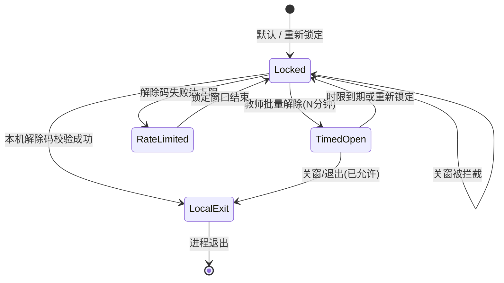

# 学生端退出锁定 · 应用层与 MDM/Kiosk

Classroom Desk 学生端默认**禁止关闭**（关窗、`Cmd/Ctrl+Q`、菜单退出）。允许退出的唯一正规途径：

1. 教师后台「批量允许关闭学生端」（限时；WebSocket/SSE 即时推送）
2. 本机「设置」输入解除码（或管理密码）后退出

## 锁定状态机



| 状态 | 学生标题栏 | 能否退出 |
|---|---|---|
| Locked | 已锁定 | 否 |
| TimedOpen | 可退出 m:ss | 是 |
| LocalExit | （正在退出） | 是 |
| RateLimited | 已锁定 | 否（需等 Retry-After） |

## 应用层已覆盖

| 路径 | 行为 |
|---|---|
| 无框窗口关闭 | 拦截，提示并跳转「设置」 |
| 应用菜单 / 快捷键退出 | 无菜单；`before-quit` 拦截 |
| `admin:quit` IPC | 未解锁拒绝 |
| 教师批量解除 | WebSocket `/api/v1/exit-lock/ws` + SSE `/api/v1/exit-lock/stream`；轮询兜底 |
| 解除码错误 | 可配置：次数 / 窗口分钟 / 锁定分钟 |
| 解除码轮换 | 超过 N 天在教师设置提醒 |

开发临时放开：`ALLOW_STUDENT_EXIT=1`。

自动化：

- `npm run verify:1plus1`（含 exit-lock 断言）
- `npm run verify:exit-lock-packaged`（打包产物静态校验；`dist:win` / CI windows-pack 会跑）

## 应用层挡不住的（需系统策略）

任务管理器「结束任务」、`taskkill /F`、`kill -9`、强制退出属于 **操作系统权限**。教室若要求系统级也关不掉，用学校 **MDM / 分配访问 / Kiosk**。

### Windows Assigned Access（单应用展台）

1. 建本地标准用户（如 `StudentKiosk`），不要给管理员权限。
2. 设置 → 帐户 → 家庭和其他用户 → **设置分配的访问权限**（Assigned Access）。
3. 选择该账户 → 选择应用 → **Classroom Desk**（若未列出：先用该账户登录一次安装的 app）。
4. 退出设置；用展台账户登录，应仅能进学生端。
5. 验证：`Ctrl+Alt+Del` / 任务管理器对展台账户不可用或无法结束被允许的应用（因 Windows 版本而异）。

### Intune / 组策略要点

- 配置文件限制：禁止任务管理器、限制「结束任务」。
- 可选：开机仅启动学生端（配合 `openAtLogin`）。
- 不要在教师机上开 Assigned Access。

#### Intune 自定义 OMA-URI 示例（参考）

将下列片段作为 **自定义配置文件** 的起点（按租户策略调整；先在试验机组验证）。完整样例文件：[`intune-student-kiosk.example.xml`](./intune-student-kiosk.example.xml)。

```xml
<!-- 概念示例：限制任务管理器 / 设置页 — 非生产即用，需学校 IT 审阅 -->
<Replace>
  <CmdID>1</CmdID>
  <Item>
    <Target>
      <LocURI>./Device/Vendor/MSFT/Policy/Config/Start/HideTaskManager</LocURI>
    </Target>
    <Meta><Format xmlns="syncml:metinf">int</Format></Meta>
    <Data>1</Data>
  </Item>
</Replace>
```

Assigned Access 多应用 JSON 片段（设置 → 帐户 → 分配的访问，或 Intune「展台」配置）：

```json
{
  "Account": "StudentKiosk",
  "Apps": [
    {
      "AppType": "DesktopApp",
      "DesktopAppPath": "C:\\\\Program Files\\\\Classroom Desk\\\\Classroom Desk.exe"
    }
  ]
}
```

路径以实际安装目录为准（NSIS 默认可能在 `Program Files\\Classroom Desk`）。

### 验证打包安装态退出锁定（C2 · 须在 Windows 真机）

本仓库 CI/代理机多为 macOS，**无法代替**教室 Windows 手测。打印下表到样机旁勾选：

| # | 步骤 | 期望 | □ |
|---|---|---|---|
| 1 | 安装 `ClassroomDesk-Setup-*.exe` | 安装成功 | |
| 2 | 写入 LAN `config.json`（禁止 127.0.0.1） | 能连 `/health` | |
| 3 | 启动学生端 | 标题栏「已锁定」；读屏可听 | |
| 4 | 关窗 / Alt+F4 | 无法退出 | |
| 5 | 教师批量解除（确认框） | 学生秒级「可退出 m:ss」 | |
| 6 | 关窗 | 可退出 | |
| 7 | 教师重新锁定后再开学生端 | 再次无法关 | |
| 8 | 解除码路径 | 可退；错码限流 | |
| 9 | 教师审计 | 可筛选 kind / 导出 CSV | |
| 10 | （可选）Assigned Access | 任务管理器不可结束 | |

静态检查：`npm run verify:exit-lock-packaged`（打包机加 `REQUIRE_WIN_EXE=1`）。总表见 [LOCAL_USB_CHECKLIST.md](./LOCAL_USB_CHECKLIST.md)「C2」。
