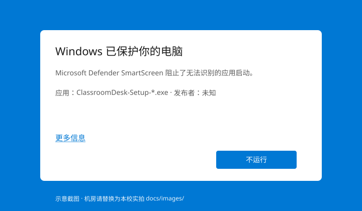
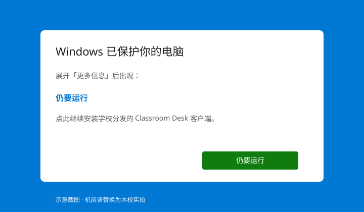
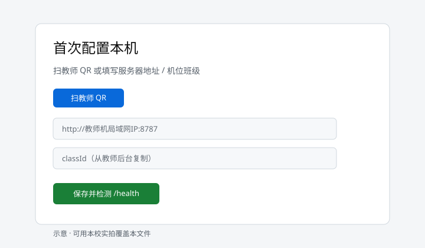

# 教室机旁 SmartScreen / 组策略放行（可打印）

**适用：** `ClassroomDesk-Setup-*.exe`（优先**已签名**发布包；未签名仅应急）  
**对象：** 任课教师 / 机房管理员  

## 首选路径（学校 IT）

1. 用**发布者代码签名证书**签署 Setup（x64 / arm64 同证书）。CI 可在仓库 secrets 配置 `WINDOWS_CERT_PFX_BASE64` + `WINDOWS_CERT_PASSWORD`（或 electron-builder 的 `CSC_LINK` / `CSC_KEY_PASSWORD`）；未配置时 workflow 跳过签名步骤。  
2. 分发 Release / USB 清单中的 exe + `.sha256`；USB 勾选见 [LOCAL_USB_CHECKLIST.md](./LOCAL_USB_CHECKLIST.md)。  
3. SmartScreen 信誉随同一发布者安装量上升；**不要**教师生关闭 Microsoft Defender 或全局关闭 SmartScreen 当「功能」。  
4. 域环境用 WDAC / AppLocker **按发布者或哈希允许**，而不是关防护。

未签名或全新发布者时，才用下方「应急放行」。连班 HTTP/PIN 边界见 [CLASSROOM_JOIN_SECURITY.md](./CLASSROOM_JOIN_SECURITY.md)。

---

## 对学生怎么说（30 秒）

「这是学校发的课堂客户端。若已是学校签名包，按正常安装即可。若提示未知发布者，等老师按学校流程处理——不要自己关杀毒软件。」

---

## A. 单机操作（无组策略时）

1. 只安装来自 **本校网盘 / 教师分发 / GitHub Release** 的安装包（核对下方 SHA256）。
2. SmartScreen 蓝屏拦截 → 点 **更多信息** → **仍要运行**。





> 上图为界面示意。请把本校实拍 PNG/JPG 覆盖到 `docs/images/smartscreen-*.svg` 同名位置（或改链接），打印给机房管理员。

3. 若被 Defender「严重威胁」拦下：打开 **Windows 安全中心 → 病毒和威胁防护 → 保护历史记录** → 对该文件选 **允许**。
4. 安装结束：安装程序会打开 **《首次引导》** 说明卡（含「打开应用」与本文交叉链接）；学生端弹出 **首次配置**（可 **扫教师 QR**），填写  
   - 服务器地址 `http://教师机局域网IP:8787`  
   - 机位班级 `classId`  
   → **保存并检测 /health**。禁止 `127.0.0.1`。  
   静默安装（`/S`）不会弹说明卡，便于组策略批量成像。



---

## B. 机房组策略 / 域控放行（批量）

适用：整间机房由 AD / 本地 GPO 管控，学生无管理员权限。

### B1. SmartScreen 对指定路径放宽（Win10/11 教育版常见）

1. `gpedit.msc`（或域 GPO）→ **计算机配置 → 管理模板 → Windows 组件 → Windows Defender SmartScreen → Explorer**。
2. **配置 Windows Defender SmartScreen** → 保持启用；用「警告」而非关闭。  
3. 用 **WDAC / AppLocker 白名单**（发布者证书或 Setup SHA256）放行，例如安装目录：  
   `C:\Program Files\Classroom Desk\`  
   `C:\Users\*\AppData\Local\Programs\Classroom Desk\`（以实际安装路径为准）。

### B2. Defender（误杀时）

优先：**允许**该次威胁历史中的 Setup（按哈希），而不是全局排除整个磁盘。  
仅在学校 IT 书面批准下，才对安装目录做窄排除；**禁止**作为教室标准作业关闭 Defender。

### B3. AppLocker / WDAC（高安全机房）

1. 以发布包 SHA256 或发布者证书（若已签名）建允许规则。
2. 未签名时：用 **路径规则** 仅允许教师分发目录（如 `D:\ClassroomDesk\Setup\`）内的 `ClassroomDesk-Setup-*.exe` 执行一次安装。
3. 安装完成后，对已安装目录建永久允许规则。

### B4. 「从 Internet 下载」标记（MOTW）

U 盘 / 网盘解压后若仍被拦，可在教师机 PowerShell（管理员）对安装包去区域标记：

```powershell
Unblock-File -Path .\ClassroomDesk-Setup-0.1.3.exe
Get-FileHash .\ClassroomDesk-Setup-0.1.3.exe -Algorithm SHA256
```

与 Release 旁 `.sha256` 文件对照，不一致则**不要安装**。

---

## 安装包校验（填写本批哈希）

| 字段 | 值 |
|---|---|
| 文件名 | ClassroomDesk-Setup-_______.exe |
| SHA256 | ______________________________________ |
| 来源 | GitHub Release / 校内网盘路径 |
| 签名 | □ 已签名（CSC）　□ 未签名（预期可能有 SmartScreen） |

---

## 长期

申请代码签名证书 → 仓库 Secrets `CSC_LINK` + `CSC_KEY_PASSWORD` → 重打签名包，SmartScreen 显著减少。

- 从零部署：[SETUP_FROM_GITHUB.md](./SETUP_FROM_GITHUB.md)  
- U 盘清单：[LOCAL_USB_CHECKLIST.md](./LOCAL_USB_CHECKLIST.md)  
- 网盘留档：[NAS_RELEASES.md](./NAS_RELEASES.md)  
- 教师机当服务器：[CLASSROOM_TEACHER_HOST.md](./CLASSROOM_TEACHER_HOST.md)
